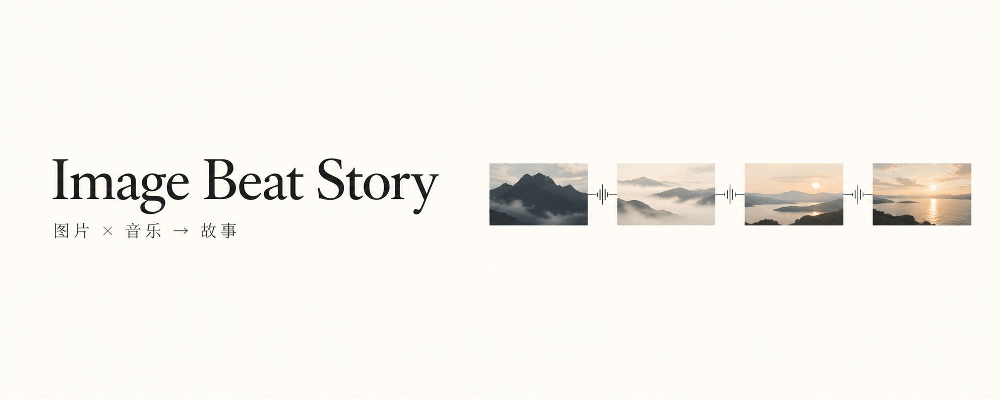

**给 Agent 一个选题、一组图片和一段音乐，编排成有故事推进与音乐卡点的短视频。**

一个完整的 Skill，内置可复用脚本和 Remotion 模板。创作由选题决定，重复工作交给工具。

```
选题 + 图片 ZIP + BGM → 图片编排 → 音乐卡点 → 视频
```

- **整理画面**：无缩放裁切、固定锚点过滤、保留叙事顺序或按配色衔接。
- **跟随音乐**：读取 BGM、检测起音候选、选择片段与落点。
- **完成剪辑**：叠化、按压回弹、明暗响应、软蒙版，用 Remotion 预览与导出。

## 安装

克隆到 Agent 的 skills 目录。Codex 示例：

```sh
git clone https://github.com/SlamWeb/image-beat-story.git "$HOME/.codex/skills/image-beat-story"
```

运行需要 Python、FFmpeg / ffprobe，以及 Node.js + Remotion。[准备运行环境 →](references/environment.md)

## 使用

提供图片 ZIP 和 BGM 文件或分享链接，描述你想表达什么：

```text
用 $image-beat-story 制作这条视频。

选题：人物保持平静，周围世界随音乐不断变化。
图片：worlds.zip
BGM：这段音频 / 抖音作品分享链接
要求：跟随钢琴敲击，转场有按下与回弹的感觉，结尾留一点余韵。
```

也可以做文字逐步出现、场景演化或情绪反转。输入顺序有意义时保留；颜色排序、锚点过滤和蒙版按需启用。

默认画布为 **1080 × 1440 · 3:4**。起音检测提供候选点，最终卡点需结合试听；目前未包含自动乐器分类或歌词识别。

[完整流程](SKILL.md) · [工具说明](references/image-tools.md) · [“坚持”制作案例](references/persistence-case.md)
